# ambientCG: Snow materials

**23 assets from [ambientCG](https://ambientcg.com), dedicated to the public domain under [CC0](https://docs.ambientcg.com/license/).** Use them in any game, free or paid, and change them however you like; no credit is needed.

PBR materials as 1K and 2K JPG maps (colour, normal GL and DX, roughness, AO, displacement), one folder per resolution. 763.5 MB in all.

This is a copy kept by [zuujis-cc0](https://github.com/zuujis-cc0) so game makers can take single files from GitHub. It is not made by or affiliated with ambientCG: the originals, often in more formats and higher resolutions, are on [ambientcg.com](https://ambientcg.com). If they help you, consider [supporting ambientCG](https://www.patreon.com/ambientCG).

Every file is listed in [MANIFEST.tsv](MANIFEST.tsv) with its size and SHA-256. More free assets: [the Zuujis collection](https://github.com/zuujis-cc0/free-game-assets#readme).

| | | | |
| :-: | :-: | :-: | :-: |
| <a href="Snow001">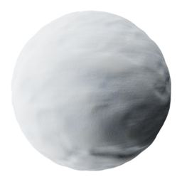</a> <b><a href="Snow001">Snow 001</a></b> by ambientCG · <a href="https://ambientcg.com/a/Snow001">source</a> | <a href="Snow002">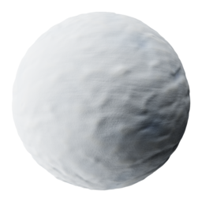</a> <b><a href="Snow002">Snow 002</a></b> by ambientCG · <a href="https://ambientcg.com/a/Snow002">source</a> | <a href="Snow003">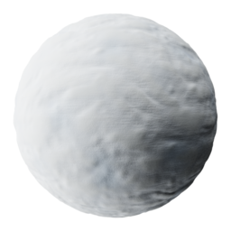</a> <b><a href="Snow003">Snow 003</a></b> by ambientCG · <a href="https://ambientcg.com/a/Snow003">source</a> | <a href="Snow004">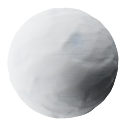</a> <b><a href="Snow004">Snow 004</a></b> by ambientCG · <a href="https://ambientcg.com/a/Snow004">source</a> |
| <a href="Snow005">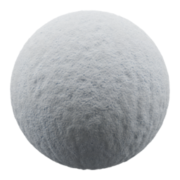</a> <b><a href="Snow005">Snow 005</a></b> by ambientCG · <a href="https://ambientcg.com/a/Snow005">source</a> | <a href="Snow006">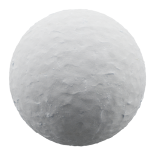</a> <b><a href="Snow006">Snow 006</a></b> by ambientCG · <a href="https://ambientcg.com/a/Snow006">source</a> | <a href="Snow007A">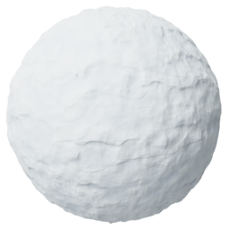</a> <b><a href="Snow007A">Snow 007 A</a></b> by ambientCG · <a href="https://ambientcg.com/a/Snow007A">source</a> | <a href="Snow007B">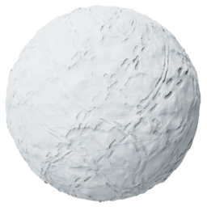</a> <b><a href="Snow007B">Snow 007 B</a></b> by ambientCG · <a href="https://ambientcg.com/a/Snow007B">source</a> |
| <a href="Snow007C">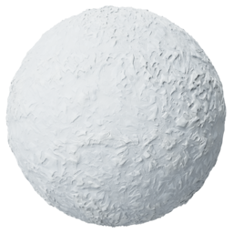</a> <b><a href="Snow007C">Snow 007 C</a></b> by ambientCG · <a href="https://ambientcg.com/a/Snow007C">source</a> | <a href="Snow008A">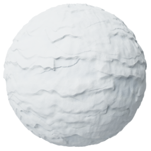</a> <b><a href="Snow008A">Snow 008 A</a></b> by ambientCG · <a href="https://ambientcg.com/a/Snow008A">source</a> | <a href="Snow008B">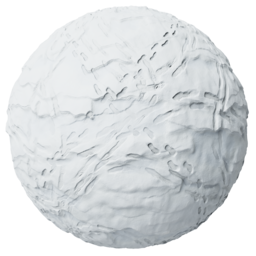</a> <b><a href="Snow008B">Snow 008 B</a></b> by ambientCG · <a href="https://ambientcg.com/a/Snow008B">source</a> | <a href="Snow008C">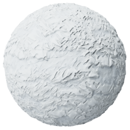</a> <b><a href="Snow008C">Snow 008 C</a></b> by ambientCG · <a href="https://ambientcg.com/a/Snow008C">source</a> |
| <a href="Snow009A">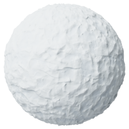</a> <b><a href="Snow009A">Snow 009 A</a></b> by ambientCG · <a href="https://ambientcg.com/a/Snow009A">source</a> | <a href="Snow009B">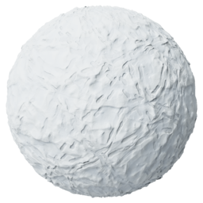</a> <b><a href="Snow009B">Snow 009 B</a></b> by ambientCG · <a href="https://ambientcg.com/a/Snow009B">source</a> | <a href="Snow009C">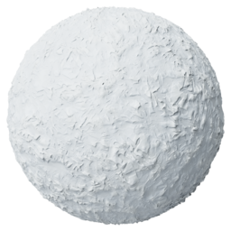</a> <b><a href="Snow009C">Snow 009 C</a></b> by ambientCG · <a href="https://ambientcg.com/a/Snow009C">source</a> | <a href="Snow010A">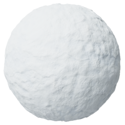</a> <b><a href="Snow010A">Snow 010 A</a></b> by ambientCG · <a href="https://ambientcg.com/a/Snow010A">source</a> |
| <a href="Snow010B">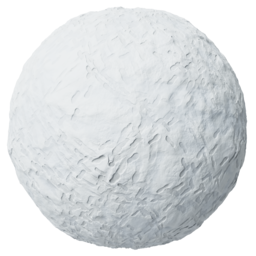</a> <b><a href="Snow010B">Snow 010 B</a></b> by ambientCG · <a href="https://ambientcg.com/a/Snow010B">source</a> | <a href="Snow010C">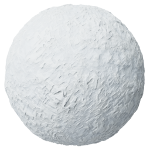</a> <b><a href="Snow010C">Snow 010 C</a></b> by ambientCG · <a href="https://ambientcg.com/a/Snow010C">source</a> | <a href="Snow011">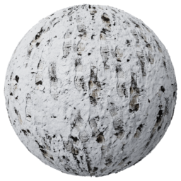</a> <b><a href="Snow011">Snow 011</a></b> by ambientCG · <a href="https://ambientcg.com/a/Snow011">source</a> | <a href="Snow012">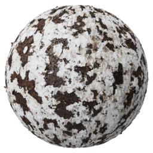</a> <b><a href="Snow012">Snow 012</a></b> by ambientCG · <a href="https://ambientcg.com/a/Snow012">source</a> |
| <a href="Snow013">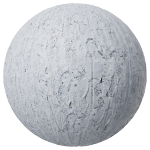</a> <b><a href="Snow013">Snow 013</a></b> by ambientCG · <a href="https://ambientcg.com/a/Snow013">source</a> | <a href="Snow014">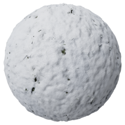</a> <b><a href="Snow014">Snow 014</a></b> by ambientCG · <a href="https://ambientcg.com/a/Snow014">source</a> | <a href="Snow015">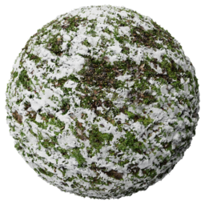</a> <b><a href="Snow015">Snow 015</a></b> by ambientCG · <a href="https://ambientcg.com/a/Snow015">source</a> |  |

---

Kept up to date by this repository's own [update workflow](.github/workflows/update.yml), with code and plan from [cc0-mirror](https://github.com/zuujis-cc0/cc0-mirror). Something wrong? [Open an issue there](https://github.com/zuujis-cc0/cc0-mirror/issues/new) or use the [private report form](https://games.zuujis.com/report).
